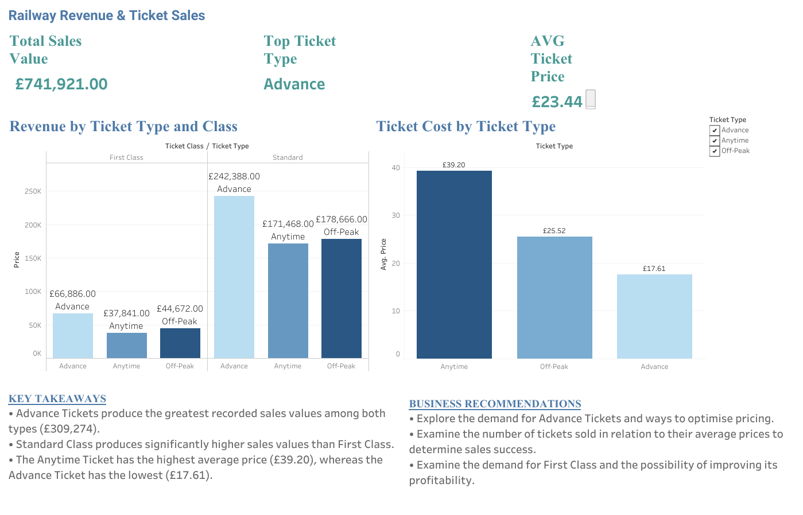
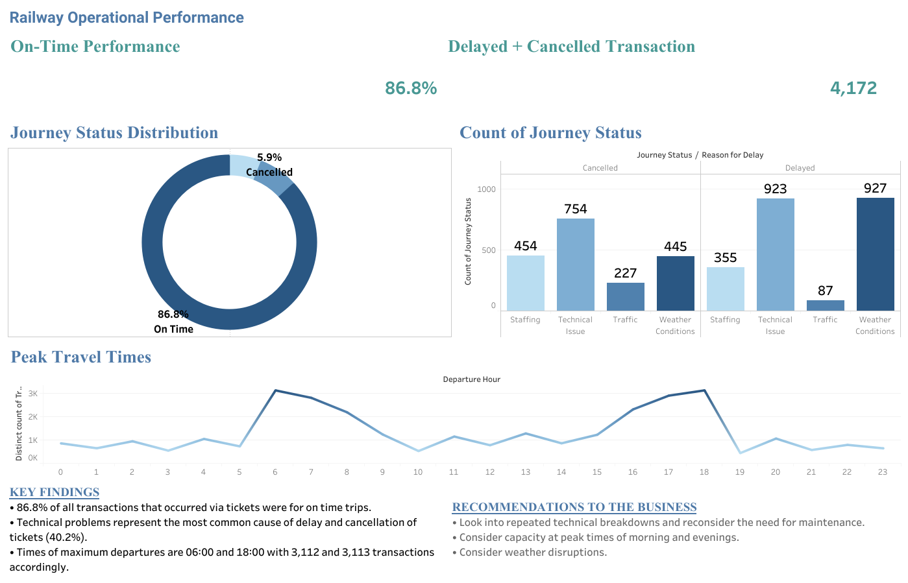

# UK Railway Data Analysis

## Project Overview

This project analyses UK railway ticket sales and operational performance using **MySQL and Tableau**.

The objective is to identify ticket sales patterns, understand peak travel periods, evaluate journey performance, investigate disruptions and provide data-driven business recommendations.

The project demonstrates a Business Intelligence workflow, from data exploration and preparation in SQL to interactive dashboard development in Tableau.

## Tools and Technologies

- **MySQL Workbench 8.0** — Data exploration, cleaning and validation
- **Tableau** — Data visualisation and dashboard development
- **SQL** — Data quality checks and data transformation
- **CSV** — Data storage and transfer
- **GitHub** — Project documentation and portfolio presentation

## Business Questions

1. What are the most popular railway routes?
2. What are the peak travel times?
3. How does ticket sales value vary by ticket type and class?
4. What percentage of recorded ticket transactions are associated with on-time journeys?
5. What are the main contributing factors to railway disruptions?

## Data Cleaning and Validation

The original railway dataset was imported into MySQL Workbench for exploration, cleaning and validation.

A staging table was created to preserve the original dataset while preparing the data for analysis.

The SQL preparation process included:

- Checking for duplicate records using `ROW_NUMBER()` and `GROUP BY`
- Checking for missing values using `IS NULL`
- Inspecting categorical values using `SELECT DISTINCT`
- Standardising selected delay reasons using `UPDATE`
- Removing leading and trailing spaces using `TRIM()`
- Checking date formats using `STR_TO_DATE()`
- Creating a backup before data type conversion
- Converting date and time columns using `ALTER TABLE`
- Reviewing the prepared dataset before importing it into Tableau

Data was modified where standardisation or data type conversion was required. Duplicate and missing-value checks were used to investigate potential data quality issues.

**SQL Script:** [View Railway Data Cleaning and Validation](railway_data_cleaning_and_validation.sql)

## Dashboard 1: Railway Revenue & Ticket Sales

### Key Performance Indicators

- **Total Recorded Ticket Sales Value:** £741,921
- **Average Ticket Price:** £23.44
- **Top Ticket Type by Sales Value:** Advance

### Key Findings

- Advance tickets generated the highest recorded sales value at **£309,274**.
- Standard Class generated substantially more sales value than First Class.
- Anytime tickets had the highest average ticket price at **£39.20**.
- Off-Peak tickets had an average price of **£25.52**.
- Advance tickets had the lowest average price at **£17.61**, despite generating the highest recorded sales value.

### Business Recommendations

1. **Investigate Advance Ticket Demand:** Examine whether higher transaction volumes explain the strong sales performance of Advance tickets.

2. **Optimise Ticket Pricing:** Analyse customer demand and ticket volumes alongside average prices to identify potential pricing opportunities.

3. **Evaluate First Class Performance:** Review First Class demand, pricing and sales patterns to identify opportunities to improve commercial performance.

## Dashboard 2: Railway Operational Performance

### Key Performance Indicators

- **On-Time Transaction Percentage:** 86.8%
- **Delayed Transactions:** 2,292
- **Cancelled Transactions:** 1,880
- **Total Delayed and Cancelled Transactions:** 4,172

### Key Findings

**Journey Performance**

- 86.8% of recorded ticket transactions were associated with on-time journeys.
- Approximately 7.2% were associated with delayed journeys.
- Approximately 5.9% were associated with cancelled journeys.

**Contributing Factors to Disruptions**

| Disruption Factor | Affected Transactions |
|---|---:|
| Technical Issues | 1,677 |
| Weather Conditions | 1,372 |
| Staffing | 809 |
| Traffic | 314 |

- Technical issues accounted for approximately **40.2%** of delayed and cancelled transactions.
- Weather conditions were the second-largest recorded disruption category.

**Peak Travel Times**

- The morning peak occurred at **06:00**, with 3,112 recorded ticket transactions.
- The evening peak occurred at **18:00**, with 3,113 recorded ticket transactions.
- These results indicate higher recorded ticket activity during morning and evening commuting periods.

### Business Recommendations

1. **Improve Technical Reliability:** Investigate recurring technical issues and review preventive maintenance priorities.

2. **Strengthen Weather Contingency Planning:** Examine weather-related disruptions and develop strategies to minimise operational impacts.

3. **Optimise Peak-Hour Operations:** Review staffing, scheduling and operational capacity during morning and evening peak periods.

4. **Monitor Operational Performance:** Track delay and cancellation trends to identify recurring issues and assess improvement initiatives.

## Tableau Workbook

The Tableau workbook contains both dashboards and the supporting visualisations used in this analysis.

**[Download UK Railway Tableau Workbook](UK_Railway_Analysis.twbx)**

The workbook can be opened using compatible Tableau software.

## Project Files

| File | Description |
|---|---|
| [railway_raw.csv](railway_raw.csv) | Original railway dataset |
| [railway_cleaned.csv](railway_cleaned.csv) | Prepared dataset used for analysis |
| [railway_data_cleaning_and_validation.sql](railway_data_cleaning_and_validation.sql) | MySQL data preparation script |
| [Railway_Revenue_Dashboard.png](Railway_Revenue_Dashboard.png) | Revenue and ticket sales dashboard screenshot |
| [Railway_Operational_Dashboard.png](Railway_Operational_Dashboard.png) | Operational performance dashboard screenshot |
| [UK_Railway_Analysis.twbx](UK_Railway_Analysis.twbx) | Tableau packaged workbook |

## Project Conclusion

This project demonstrates how SQL and Tableau can be used together to transform railway ticketing data into meaningful business information.

The revenue analysis identifies differences in ticket pricing and recorded sales value across ticket types and classes.

The operational analysis highlights on-time performance, peak departure periods and the most frequently recorded disruption factors.

These findings provide a foundation for investigating pricing strategies, improving operational reliability and supporting data-driven decision-making.

## Data Source

**Dataset:** UK Railway Ticketing Data

**Original Source:** Add the original dataset provider and source URL here.

## Important Notes

- Recorded ticket sales value is based on ticket prices and should not be interpreted as net revenue after refunds unless refund adjustments have been applied.
- Operational performance percentages are based on ticket transactions rather than unique train services.
- Disruption findings describe recorded associations and do not independently establish the underlying causes.
- Data cleaning and validation activities are documented in the SQL script.
